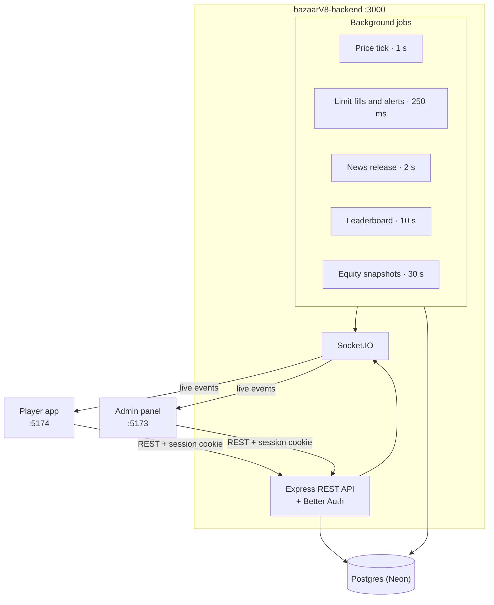
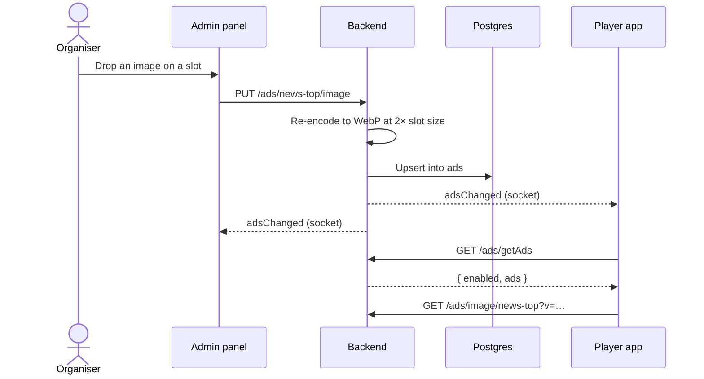

# Bazaar — Backend

The API, price engine and trading engine for **Bazaar**, the live stock market game run by the Bulls & Bears PDEU team. It simulates a market that ticks every second, settles trades long and short, runs IPOs and news-driven price moves, and pushes everything to the apps live over Socket.IO.

Bazaar is split across three repositories:

| Repo | What it is | Dev port |
| --- | --- | --- |
| **bazaarV8-backend** (this repo) | API, engines, auth, realtime | `3000` |
| [bazaarV8-admin](https://github.com/Bulls-Bears-PDEU/bazaarV8-admin) | Organiser panel | `5173` |
| [bazaarV8-frontend](https://github.com/Bulls-Bears-PDEU/bazaarV8-frontend) | Player app (screenshots of every page are in its README) | `5174` |

## How it works



- **Price engine** (`src/stockEngine.ts`). Every second each stock moves by geometric Brownian motion, with stocks in the same sector moving together. Admin news adds directed moves to the stocks it names, and market sentiment (bullish, bearish, neutral) reprices and tilts the whole board. The maths and tuning are documented in [docs/stockEngine.md](docs/stockEngine.md).
- **Trading engine** (`src/trading/`). Market orders fill at the live price. Limit orders rest, with cash reserved, until a tick crosses them, and are then settled by a separate 250 ms loop so a burst of fills never delays prices. Positions are signed: Buy and Sell manage a long, Short and Cover manage a short against a margin set by the organisers. A position is closed before it can flip sides.
- **Everything is computed here.** Portfolio values, P&L, ranks, previews and the leaderboard are calculated on the server and sent to the apps, which only display them. This keeps players from changing their numbers in the browser.
- **Auth** uses [Better Auth](https://www.better-auth.com) with email and password, email verification codes and password resets sent through [Resend](https://resend.com). New accounts start as `pending` and can't use the API until an organiser approves them.
- **Sponsor ads** (`src/controller/ads.ts`). Organisers upload one ad per slot the player app reserves; see [Sponsor ads](#sponsor-ads) below.
- **Schema** is created and migrated on startup by `initDB()` in `src/database/schema.ts`. A hash in `schema_meta` lets startup skip the migration when nothing has changed.

## Getting started

### Prerequisites

- Node.js 22 or newer
- [pnpm](https://pnpm.io)
- A Postgres database. The project uses [Neon](https://neon.tech); any Postgres 15+ should work.
- A [Resend](https://resend.com) API key, if you need sign-up verification and password-reset emails to actually send.

### Run it

```bash
pnpm install
cp .env.example .env  # then fill in the required values (see below)
pnpm dev              # creates or updates the schema, then starts on :3000
pnpm seed:stocks      # in another terminal, once: seed stocks and price history
```

`pnpm seed:stocks` resets prices and history, so stop the server before running it again on an existing database.

Then start the [admin panel](https://github.com/Bulls-Bears-PDEU/bazaarV8-admin) and the [player app](https://github.com/Bulls-Bears-PDEU/bazaarV8-frontend), sign up, and promote yourself:

```bash
pnpm set-role you@example.com admin
```

### Environment variables

Copy [.env.example](.env.example) to `.env` in the repo root. Only the first three variables are required; the rest are commented out with their defaults.

| Variable | Required | Default | Purpose |
| --- | --- | --- | --- |
| `DATABASE_URL` | Yes | — | Postgres connection string |
| `BETTER_AUTH_SECRET` | Yes | — | Secret Better Auth uses to sign sessions |
| `RESEND_API_KEY` | For email | — | Sends verification codes and password-reset links |
| `PORT` | No | `3000` | HTTP and Socket.IO port |
| `BACKEND_URL` | No | `http://localhost:$PORT` | Public URL of this server, used as Better Auth's base URL |
| `ADMIN_APP_URL` | No | `http://localhost:5173` | Admin panel origin |
| `PLAYER_APP_URL` | No | `http://localhost:5174` | Player app origin; password-reset links fall back to it |
| `FRONTEND_ORIGINS` | No | Admin and player URLs | Comma-separated list of origins allowed to call the API and open a socket with cookies |
| `TRADING_DATABASE_URL` | No | `DATABASE_URL` | Direct (non-pooler) Neon endpoint for the pool that runs trading writes |
| `ENABLE_STOCK_DB_UPDATES` | No | `true` | Set to `false` to stop the engine writing OHLC candles to the database |
| `BETTER_AUTH_API_KEY` | No | — | API key for the Better Auth dashboard plugin |

Never commit `.env`; it is already in `.gitignore`.

## Scripts

| Command | What it does |
| --- | --- |
| `pnpm dev` | Run `src/server.ts` with `tsx`, restarting on changes |
| `pnpm build` | Compile TypeScript into `dist/` |
| `pnpm start` | Run the compiled server from `dist/` |
| `pnpm seed:stocks [count] [candles]` | Seed NSE large caps with realistic prices and recent 10-second candles. Matches stocks by symbol, so holdings and orders are kept |
| `pnpm set-role <email> <admin\|user\|pending>` | Change a user's role |
| `pnpm set-logos [folder]` | Upload stock logos from a folder (default `assets/logos`), matched by file name, e.g. `RELIANCE.png` |
| `pnpm smoke:trading` | End-to-end check of settlement against the real database: buys, sells, shorts, covers, flips, rejections, margin and concurrent orders. Creates and deletes its own user and stock |

## API

All routes except auth, logos, avatars and ad images require an approved user's session cookie. Routes marked **admin** also require the `admin` role.

| Prefix | Covers |
| --- | --- |
| `/api/auth/*` | Better Auth: sign up, sign in, sessions, email verification, password reset |
| `/stocks` | Stock list and search, sectors, live prices, OHLC history, logos; **admin**: add and edit stocks, upload logos |
| `/market` | Market state, overview, Bazaar index and its history; **admin**: pause, sentiment, trading rules |
| `/orders` | Trade context and preview, place, modify and cancel orders, open orders, history, trade ledger |
| `/portfolio` | Holdings, equity curve, closed positions, P&L summary, sector allocation |
| `/watchlists` | Create, rename, delete and reorder watchlists and their stocks |
| `/alerts` | Create, list and cancel price alerts |
| `/ipos` | Open IPOs, apply, preview, withdraw, my applications; **admin**: create, edit, change status, review applications, run allotment |
| `/news` | Released news; **admin**: write, edit, schedule, release, hide and delete news with price impacts |
| `/leaderboard` | Ranked players and the caller's rank |
| `/users` | Avatars, update own profile; **admin**: approve a user |
| `/admin/users` | **admin**: list, search, stats, edit and bulk-update users |
| `/admin/god` | **admin**: adjust a player's cash and positions, flatten, cancel orders, reset, and the action log |
| `/ads` | Live ads and the show/hide switch, ad images; **admin**: every slot, upload, edit and remove ads, hide all ads |

Placing orders and applying for IPOs is refused while the market is paused and until a newly approved player has finished onboarding.

## Sponsor ads

The player app reserves fixed spaces for sponsor ads. Each space is a **slot** with a name and a standard size, defined in `AD_SLOTS` in `src/controller/ads.ts`:

| Slot | Where | Size |
| --- | --- | --- |
| `news-top` | News article, above the story | 728 × 90 |
| `news-in-article` | News article, inside the story | 728 × 90 |
| `news-sidebar-1` | News article sidebar, upper | 300 × 250 |
| `news-sidebar-2` | News article sidebar, lower | 300 × 250 |
| `news-list` | News page sidebar | 300 × 250 |
| `market-paused` | Screen shown while the market is paused | 300 × 250 |

Each slot holds at most one ad: an image, a sponsor name (used as alt text), an optional link, and a live/paused flag. Images are stored in the database like stock logos. Whatever is uploaded is re-encoded to WebP at twice the slot size, without cropping. One switch, stored in `ad_settings`, hides every ad at once. While it is off, players see no ads and no empty ad spaces.

| Method and path | Who | What it does |
| --- | --- | --- |
| `GET /ads/image/:slot` | Public | The slot's image. The URL carries a version, so it is cached for good |
| `GET /ads/getAds` | Approved users | `{ enabled, ads }`: live ads only |
| `GET /ads/getAdsAdmin` | Admin | `{ enabled, slots }`: every slot with its size and its ad, if any |
| `PUT /ads/:slot/image` | Admin | Upload or replace the image. The body is the raw PNG, JPEG or WebP, up to 8 MB. Uploading to an empty slot creates its ad |
| `PATCH /ads/:slot` | Admin | Change any of `sponsor`, `link_url` (http or https only) and `is_active` |
| `DELETE /ads/:slot` | Admin | Remove the ad; the slot shows its placeholder again |
| `PATCH /ads/setAdsEnabled` | Admin | `{ enabled }`: show or hide every ad |

Every change broadcasts `adsChanged`, so open apps refetch straight away:



## Realtime

Socket.IO shares the HTTP port and authenticates with the same session cookie. On connect each socket joins:

| Room | Who | Main events |
| --- | --- | --- |
| `user:<id>` | Every user | `portfolioTick`, `walletUpdate`, `orderPlaced`, `orderFilled`, `orderModified`, `orderCancelled`, `orderRejected`, `priceAlertTriggered`, `ipoApplicationUpdate`, `profileUpdated` |
| `market` | Approved users and admins | `marketTick`, `indexTick`, `leaderboard_update`, `newsReleased`, `newsChanged`, `stocksChanged`, `iposChanged`, `adsChanged` |
| `lobby` | Pending users | `marketStateUpdate` only |
| `admins` | Admins | `stockPriceUpdate`, `usersChanged`, `newsChanged`, `adminActionLogged` |

`marketStateUpdate` goes to the `market` and `lobby` rooms on connect and whenever an organiser pauses the market or changes sentiment.

## Project structure

```text
src/
├── server.ts          Entry point: migrate schema, start jobs, listen
├── app.ts             Express app, routers, Socket.IO, background jobs
├── stockEngine.ts     Price simulation (GBM, sectors, news, sentiment)
├── marketIndex.ts     Bazaar index
├── config/            Environment parsing
├── database/          Connection pools and schema migration
├── lib/               Better Auth setup, sessions, email, image handling, caches
├── middleware/        requireAdmin, requireApprovedUser, requireOnboarded,
│                      requireMarketOpen, socketAuth
├── routes/            Express routers (one per API prefix)
├── controller/        Business logic behind each router
├── models/            Types for database rows and API payloads
├── trading/           Order pricing, preview, limit-order matcher, alerts, errors
├── realtime/          Socket rooms and emitters, live portfolio publishing
└── scripts/           seed, set-role, set-logos, trading smoke test
assets/logos/          Stock logos used by `pnpm set-logos`
docs/stockEngine.md    How prices, news impacts and sentiment are modelled
```

## Notes

- The database is remote, so expect a few hundred milliseconds per query in development. Requests slower than 2 seconds are logged as `Slow request`, which is the first place to look when a screen hangs.
- Biome uses tabs and double quotes. Run `pnpm biome check` before committing.

## License

[GPL-3.0](LICENSE)
